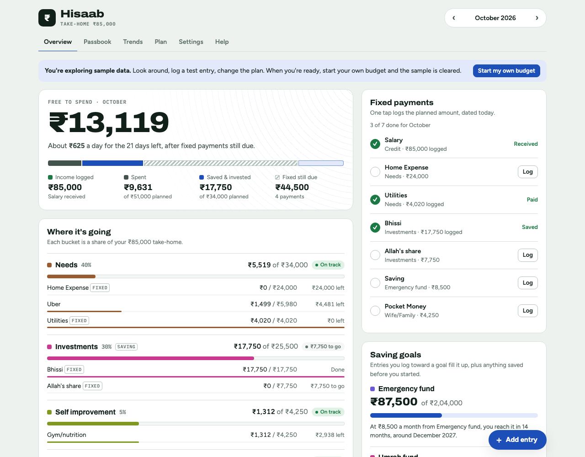
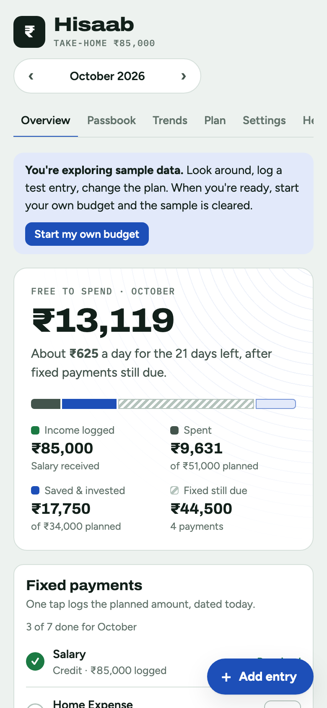

<h1 align="center">Hisaab</h1>

A free monthly budget book that gives every rupee a job. 
<b>40 · 30 · 5 · 5 · 10 · 10</b>

  <a href="https://buberearbaz-web.github.io/hisaab/"><b>Open Hisaab</b></a>
  &nbsp;·&nbsp;
  <a href="https://buberearbaz-web.github.io/hisaab/#demo">Try it with sample data</a>
  &nbsp;·&nbsp;
  <a href="https://www.pinterest.com/buberearbaz/">Follow on Pinterest</a>

## The split

Hisaab divides your take-home pay into six buckets before the month starts, then tracks what you actually spend and save against each one.

| Share | Bucket | What goes in it |
|---:|---|---|
| 40% | Needs | Rent or EMI, groceries, bills, transport |
| 30% | Investments | Halal funds, gold, your own business |
| 5% | Self improvement | Books, courses, skills |
| 5% | Health | Gym, doctor, insurance |
| 10% | Emergency fund | Until six months of needs are saved |
| 10% | Family | Parents, relatives, sadaqah |

Every percentage, bucket and line is yours to change.

## What it does

- **Free to spend.** One number for what's left this month after spending, savings and the fixed payments still due, plus a daily figure for the days remaining.
- **Fixed payments.** A monthly checklist of salary, rent, SIP and the rest. One tap logs each one.
- **Passbook.** Every entry for the month, newest first, with search and filters.
- **Saving goals.** Emergency fund, Umrah, a house deposit. Hisaab shows when you'll reach each one at your current rate.
- **Zakat estimate.** Enter today's nisab and it works out 2.5% of your tracked savings.
- **No riba.** Income categories are salary, business, freelance, rent and gifts. There is no interest category.
- **Trends.** Six months of spending by bucket, your biggest lines and your savings rate.
- **Two starting formats.** The original Hisaab Ledger plan (12 lines) or a detailed starter (17 lines).
- **12 currencies.** Rupee, taka, dirham, riyal, rial, dinar, dollar, pound and euro.
- **Guided tour and Help.** A one-minute tour on first open, and a Help tab explaining every button.

## Your data

Hisaab has no server, no account and no analytics. Everything you enter is saved in your browser's local storage on your own device, and nothing is sent anywhere.

That also means clearing your browser data erases it. Use **Settings → Save backup file** once a month. The same screen restores a backup on a new phone.

## Use it

Open the link above on your phone and bookmark it. Open it in the same browser each time, because each browser keeps its own copy.

### Run your own copy

Hisaab is one HTML file with no build step.

1. Fork this repository.
2. Go to **Settings → Pages**, choose **Deploy from a branch**, then pick `main` and `/ (root)`.
3. Your copy is live at `https://<your-username>.github.io/hisaab/` within a minute or two.

You can also download `index.html` and open it directly in a browser.

### Make it yours

Near the top of the script in `index.html`:

- `LINKS` holds the GitHub and Pinterest links shown in Settings and the footer.
- `LEDGER` and `SPLIT` are the two starting formats. Change the bucket names, shares and lines there.

## Contributing

Ideas and bug reports are welcome in [Issues](../../issues). Pull requests are welcome too. Keep it to the single `index.html` file so anyone can still host it for free.

## License

[MIT](LICENSE)
